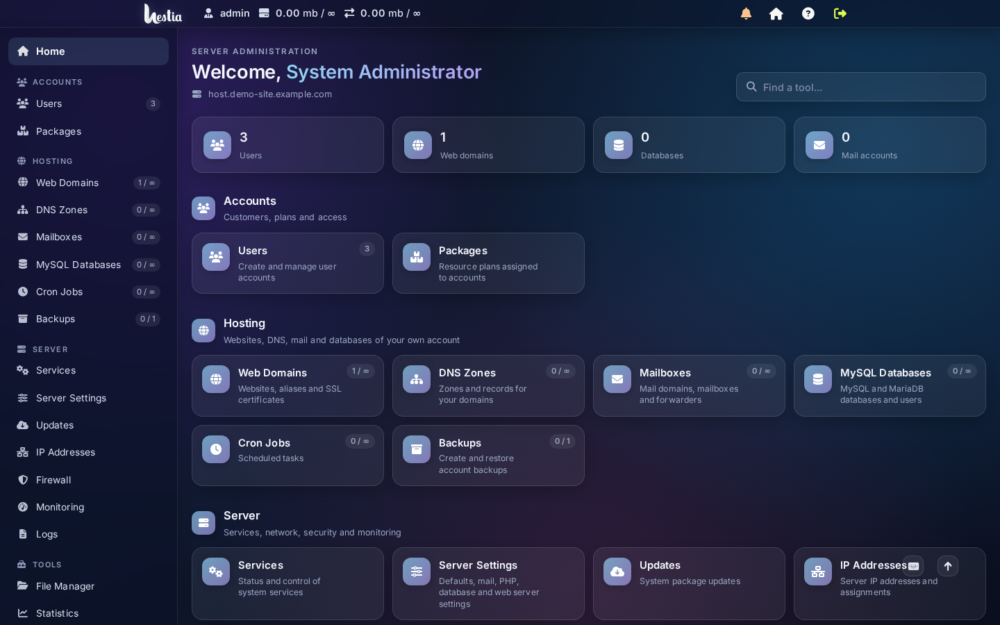
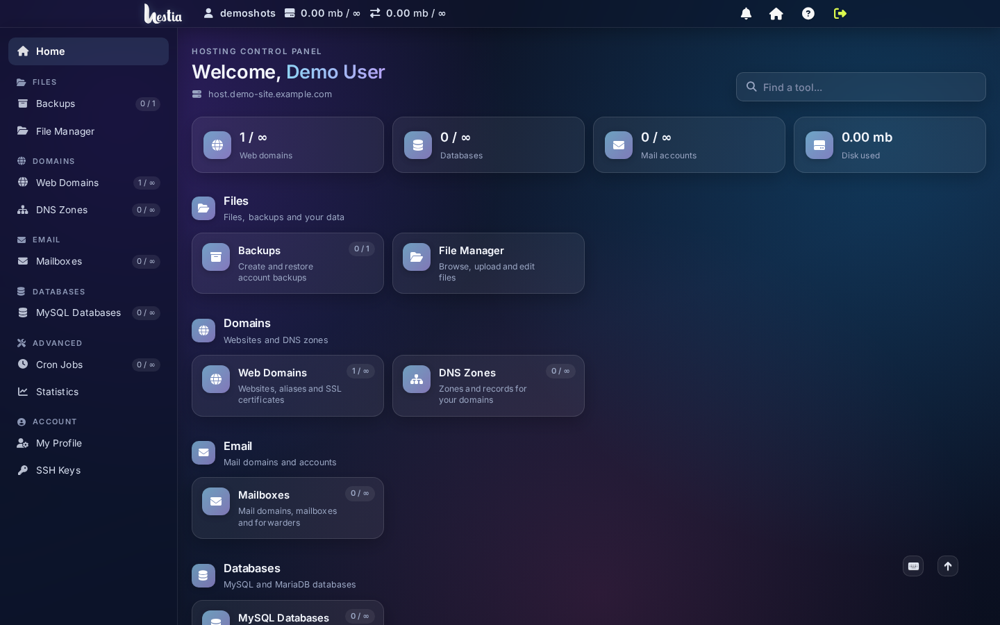
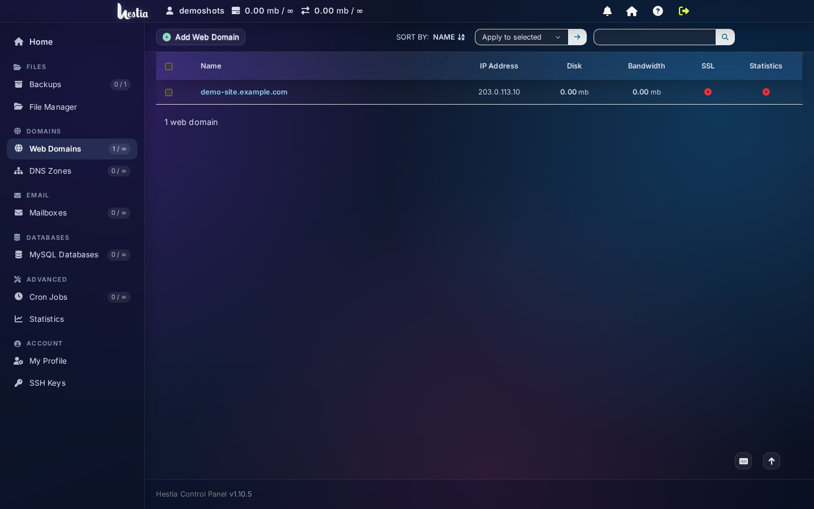
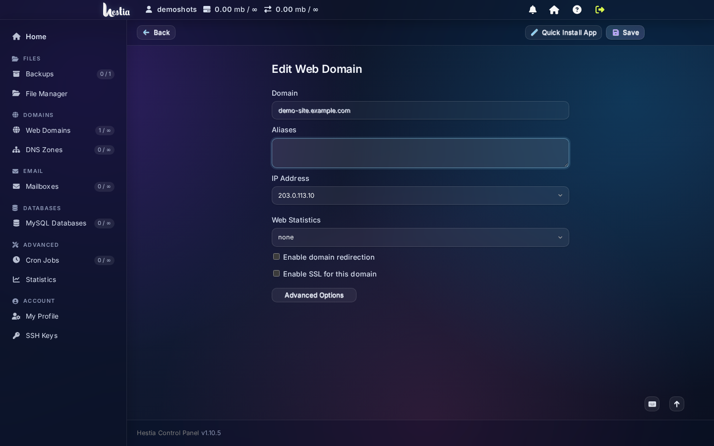
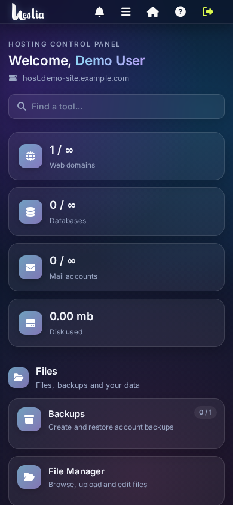
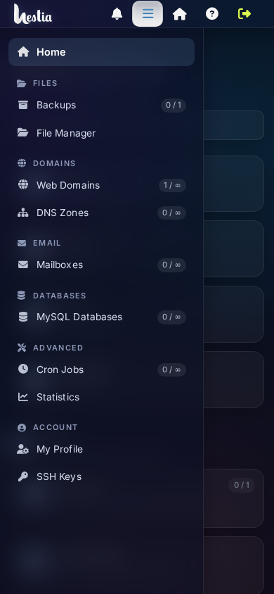

# Hestia Glass

A cPanel / DirectAdmin style layout and a frosted-glass theme for the
[Hestia Control Panel](https://hestiacp.com/) web interface.

- Grouped sidebar with icons and live counters, per account type (admin / customer)
- Tile home page at `/home/` with category sections and a search box
- Glass theme: soft surfaces, readable text, calm hover states
- Inter font, self-hosted (no external requests)

> This project is not affiliated with or endorsed by the Hestia Control Panel project.

## Screenshots

Screenshots use a demo account and placeholder names. No real domains or addresses are shown.

**Admin: tile home**


**Customer: tile home**


**Customer: web domains with the sidebar**


**Edit form: readable text on dark glass**


**Phone: tile home and side menu**

<p>


</p>

## Compatibility

Built and tested for **Hestia Control Panel 1.10.5** on Ubuntu 26.04.
Hestia's web templates change between releases, so check the version before installing.

## Install

Run on the server, as root:

```bash
git clone https://github.com/<your-user>/hestia-glass.git
cd hestia-glass
sudo bash install.sh --set-theme
```

Options:

- `--set-theme`: make Glass the server default theme. Without it, choose Glass per user (Edit user > Theme).
- `--force`: install on a different Hestia version. Check the result afterwards.

The installer backs up the original web files to `/root/hestia-glass-backup-<date>.tar.gz`
and restores them if a PHP file fails to parse.

To undo:

```bash
sudo tar -xzf /root/hestia-glass-backup-<date>.tar.gz -C /usr/local/hestia
sudo /usr/local/hestia/bin/v-change-sys-config-value THEME dark   # if you used --set-theme
```

## After a Hestia update

Hestia overwrites its web templates during updates. Run `sudo bash install.sh` again.

## What is changed

| File | Purpose |
| --- | --- |
| `inc/nav.php` | Menu model: categories, icons, and visibility rules that follow the account's package |
| `templates/includes/sidebar.php` | Grouped left sidebar |
| `templates/includes/panel.php` | Top bar (replaces the old horizontal menus) |
| `templates/pages/home.php`, `home/index.php` | Tile home page at `/home/` |
| `index.php` | Login redirects to `/home/` |
| `templates/includes/css.php` | Loads `css/hx-layout.css` for every theme |
| `css/hx-layout.css` | Layout structure (sidebar, tiles, responsive rules) |
| `css/themes/custom/glass.css` | Glass colors, typography, and effects |
| `css/fonts/` | Inter font files (SIL Open Font License) |

## Known limits

- Dialogs and forms are checked on the main pages only. Please report any unreadable text with a screenshot.
- The interface is in English. Labels use Hestia's translation function, so translations can be added.

## Credits and licenses

- Code: GNU GPL v3.0, see [LICENSE](LICENSE). The changed Hestia templates are derived from GPL-3.0 code.
- Inter font: SIL Open Font License 1.1, see [third_party/INTER-OFL.txt](third_party/INTER-OFL.txt).
